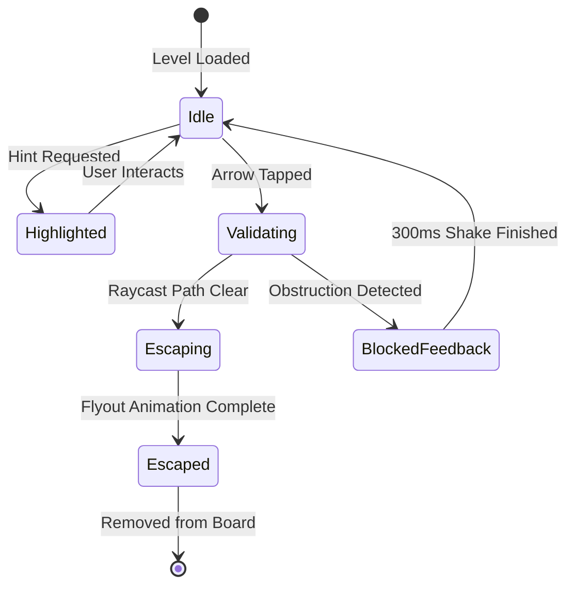

# Arrow Escape — Game Design Specification (GDS)

## 1. Core Mechanics & Coordinate System

### 1.1 Grid Geometry
- The playfield is defined as a uniform 2D discrete grid of dimensions $W \times H$ (e.g., $3 \times 3$ to $8 \times 8$).
- Coordinate origin $(0, 0)$ resides at the **Top-Left** of the grid.
- Horizontal axis $x \in [0, W - 1]$ increases from left to right.
- Vertical axis $y \in [0, H - 1]$ increases from top to bottom.

### 1.2 Cardinal Directions & Vector Offsets
Arrows point in one of four cardinal directions:

| Direction | Enum / String | Vector $(\Delta x, \Delta y)$ | Escape Condition Edge |
|---|---|---|---|
| **UP** | `'UP'` | $(0, -1)$ | Escapes across boundary $y < 0$ |
| **DOWN** | `'DOWN'` | $(0, 1)$ | Escapes across boundary $y \ge H$ |
| **LEFT** | `'LEFT'` | $(-1, 0)$ | Escapes across boundary $x < 0$ |
| **RIGHT** | `'RIGHT'` | $(1, 0)$ | Escapes across boundary $x \ge W$ |

---

## 2. Mathematical Raycasting & Collision Detection

### 2.1 The Raycast Algorithm
When an arrow $A$ at position $(x_A, y_A)$ with direction $D = (\Delta x_A, \Delta y_A)$ is evaluated:
1. Initialize test ray position $P_1 = (x_A + \Delta x_A, y_A + \Delta y_A)$.
2. While $0 \le P_x < W$ and $0 \le P_y < H$:
   - Check if any active arrow $B$ exists at position $P$.
   - If an active arrow $B$ occupies $P$:
     - **Result:** **BLOCKED**.
     - Obstacle identifier: $B.id$.
     - Return `{ canEscape: false, blockerId: B.id, blockerPos: P }`.
   - Increment: $P \leftarrow (P_x + \Delta x_A, P_y + \Delta y_A)$.
3. If the loop terminates without encountering any active arrow:
   - **Result:** **CLEAR (CAN ESCAPE)**.
   - Return `{ canEscape: true, blockerId: null }`.

### 2.2 Board Clearance & Win Condition
- Board state is maintained as an array of active arrows: `activeArrows: Arrow[]`.
- Each valid move filters out the escaped arrow from active play:
  $$\text{activeArrows}_{t+1} = \text{activeArrows}_t \setminus \{A_{\text{escaped}}\}$$
- **Victory Condition:**
  $$\text{count}(\text{activeArrows}) = 0$$

---

## 3. Arrow States & Interaction Lifecycle

### 3.1 Interaction Responses

#### A. Valid Move (Path Clear)
1. **State:** Changes immediately to `'escaping'`.
2. **Animation:** Accelerates along its direction vector beyond the screen edge ($v_0 = 0$, quadratic spring acceleration, duration ~250–350ms).
3. **Motion Trail:** Emits a subtle gradient fade trail in the arrow's accent color.
4. **Haptics:** Light crisp tactile impact (`Haptics.impactAsync(Light)`).
5. **Audio:** High pitched pleasant pop/whoosh (`sfx_arrow_escape_[1..5].mp3` pitched up sequentially per consecutive combo).
6. **Board Reaction:** Neighboring arrows pulse subtly as new space is revealed.

#### B. Invalid Move (Path Blocked)
1. **State:** Enters `'blocked'` state for 320ms.
2. **Animation:** Horizontal or vertical damped jiggle (e.g., $\pm 6\text{px}$ shake perpendicular or slight forward impulse bouncing back against blocker).
3. **Obstruction Highlight:** The blocking arrow briefly flashes an amber/red warning outline.
4. **Haptics:** Soft double buzz (`Haptics.notificationAsync(Warning)`).
5. **Audio:** Muted wooden tap or gentle dull 'thud' (`sfx_blocked.mp3`).
6. **Penalties:** **None** in standard mode (no move count punishment or lives lost).

---

## 4. Star Rating & Move Efficiency Model

Arrow Escape employs a strategic star rating system that rewards economy of moves while remaining casual and replayable:

$$\text{Optimal Moves} = N \quad (\text{where } N \text{ is the total number of arrows})$$

In a perfect run with no invalid taps:
- $\text{Actual Moves} = \text{Valid Moves} + \text{Invalid Taps}$

### Star Benchmarks
| Stars | Condition | Player Feedback |
|---|---|---|
| ⭐⭐⭐ (3 Stars) | $\text{Actual Moves} = N$ (Zero invalid taps) | "Flawless Execution!" |
| ⭐⭐ (2 Stars) | $N < \text{Actual Moves} \le N + \lceil 0.3 \times N \rceil + 1$ | "Great Job!" |
| ⭐ (1 Star) | Level completed with more taps than 2-star threshold | "Solved!" |

---

## 5. Visual Language & Style Guide ("Premium Casual")

- **Geometry:** Smooth squircle tiles (border-radius 16–20px), pill-shaped arrow shafts with rounded chevron heads.
- **Color Palette (Default Theme: "Dawn Softness"):**
  - Background: `#F8F9FD` (Clean, warm off-white)
  - Grid Board Container: `#ECEFF8` (Subtle recessed card with inset shadow)
  - Arrow Body (Idle): `#4F46E5` (Vibrant Indigo) with subtle gradient to `#6366F1`
  - Arrow Glyphs: `#FFFFFF`
  - Highlight / Hint: `#F59E0B` (Warm Amber Glow)
  - Blocked Flash: `#EF4444` (Gentle Coral Red)
  - Victory Glow: `#10B981` (Emerald Green)
- **Typography:** Rounded modern sans-serif (`Outfit` or `Nunito`).
- **Camera/Perspective:** Clean orthogonal 2D top-down view with micro-elevations (2–4dp elevation shadow).
